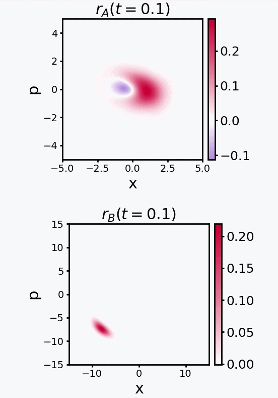
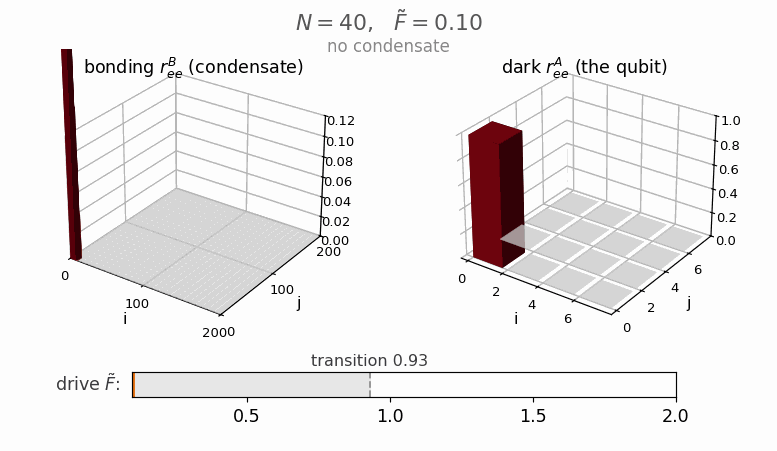

# Dissipative Time Crystals as Passively Protected Oscillating Qubits

**arXiv:** https://arxiv.org/abs/2602.20269

Numerical simulations and Liouvillian spectral analysis of dissipative time crystals and passive quantum error protection in the driven-dissipative Bose–Hubbard dimer.

<p align="center">
  
</p>

This repository contains the numerical simulations and Liouvillian spectral analysis underlying our study of dissipative time-crystalline phases in the driven–dissipative Bose–Hubbard dimer (BHD).

We show that the time-crystalline phase hosts a long-lived oscillatory mode corresponding to a noiseless subsystem, enabling passive protection of an oscillating qubit encoded in the Liouvillian spectrum.

The GIF shows the response of the BDH time-crystalline state to a phase kick.

<p align="center">
  
</p>

The second animation sweeps the drive across the dissipative phase transition at N = 40: the bonding condensate switches on and marches out while the dark qubit mode stays microscopic.

## Repository Contents

### 1. Exact Diagonalization (Dense)

- Full Liouvillian construction in symmetry-resolved sectors  
- Dense exact diagonalization  
- Script containing CPU implementation (NumPy / SciPy) GPU implementation (PyTorch)

The repository includes the eigenstates for the parameter set used in the paper for:

F = 1.8, N = 1

Eigenvectors for other drive strengths (F) and scaling values (N) can be generated directly using the provided scripts.

### 2. Sparse Spectral Computations
- Sparse Liouvillian construction  
- Krylov / ARPACK-based eigensolvers  
- Designed for cluster-scale simulations  

All sparse eigenpairs used in the paper are included, which were obtained using the High Performance Compute (HPC) compute cluster at the Advanced Research Computing (ARC) services provided to University of Oxford.

These correspond to the isolated imaginary eigenmodes responsible for time-crystalline oscillations and their finite-size scaling behavior.

## Environment Setup

This project was developed with:

Python 3.13.2

To reproduce the environment, install **conda**, and run:

```bash
conda create -n myenv python=3.13.2
conda activate myenv
conda install --file conda-spec.txt
pip install -r requirements.txt

## Branch tables (v2)

`data/branch-tables/` holds the two-anchor tracked eigenvalue branches used for the dense lines of Figs. 1 and 3 of the paper. Drive grid: base step 0.02 over F = 0.1 to 2.0 (0.05 over 0.2 to 2.0 at N = 50), plus added points including the operating drive F* = 1.23.

- `lam_N{10,20,40}.csv`: slow coherence eigenvalue per branch, columns F, Re_low, Im_low, Re_high, Im_high (in units of the loss rate).
- `nb_N{10,20,40}.csv`: condensate order parameter, columns F, nB_over_N.
- `n4sweep_summary.csv`: N = 4 exact sweep, both branches, with overlap diagnostics.
- `n{10,20,40,50}k8line_dist*.csv`: normalized Hilbert-Schmidt distances along the tracked branch, columns F, branch, d_pp_mm (sector distance), d_pp_pm (even-odd distance), at the antibonding cutoff K_A = 8.
- `n{40,50}k8line_qubit.csv`: distances together with the branch eigenvalue (lam_re, lam_im) and trace diagnostics.
